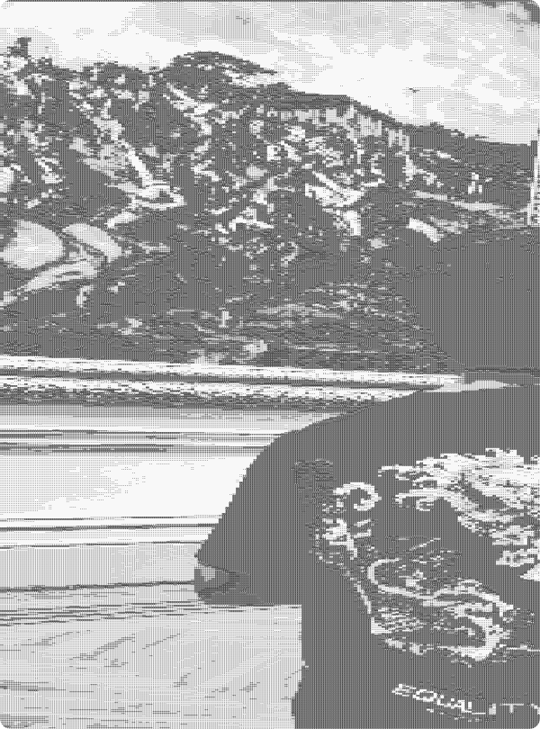

<h1 align="center">Olá, eu sou o Rafael Gentili 👋</h1>

  

  

---

## 🧑‍💻 Sobre mim

### 💻 Desenvolvedor Full Stack

Do banco de dados à interface.

### 🌐 Sites e landing pages

Para empresas e profissionais, com foco em performance, SEO e animações.

### 🎨 UI/UX Designer

Identidade visual, design systems e experiência do usuário.

### 🚀 Produtos SaaS próprios

Software B2B para o mercado.

### 🎓 Estudante na UNIFENAS

📍 Minas Gerais, Brasil

 

---

## 🛠️ Tecnologias e ferramentas

### Frontend

  

### Backend e banco de dados

  

### Design e ferramentas

  

### Animações

  

---

## 📫 Vamos conversar?

  
  
  
  

  

